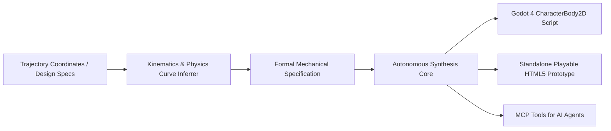

# GEA — Game Engine & Mechanics Anything 🎮🕹️

> **Autonomous Game Systems Deconstruction, Physics Trajectory Fitting, and Godot 4 / Web Clean-Room Mechanics Synthesis Engine.**

GEA is an agentic game mechanics architect. It ingests player motion recordings, coordinate trajectories, and mechanical game design specs, mathematically derives **jump curves, friction vectors, coyote time, and collision state machines**, and synthesizes production-ready **Godot 4 CharacterBody2D GDScript** and **instant playable HTML5 Canvas prototypes**.

---

## ⚡ Architecture



---

## 🚀 Key Capabilities

- **Mathematical Kinematics Fitting**:
  - Jump height ($h$) & time to apex ($t_{apex}$) $\rightarrow$ Gravity ($g = \frac{2h}{t_{apex}^2}$) and Jump Velocity ($v_0 = \frac{2h}{t_{apex}}$).
  - Variable jump height with fall multipliers.
- **Juicy Platformer Feel**:
  - Automated Coyote Time (grace period after leaving ledge).
  - Jump Buffering (queuing jump inputs before touching ground).
  - Acceleration & Friction smoothing.
- **Godot 4 Synthesis**: Generates ready-to-attach GDScript for Godot 4 `CharacterBody2D`.
- **Zero-Dependency Playable Web Engine**: Generates a self-contained HTML5 Canvas game file with 60 FPS physics loop for instant verification in any browser.
- **Model Context Protocol (MCP)**: Plugs directly into AI agents to turn them into gameplay designers.

---

## 🛠️ CLI Usage

### 1. Derive Kinematics from Jump Height & Time
```bash
npx gea fit --height 120 --time-to-apex 0.35
```

### 2. Synthesize Godot 4 Controller
```bash
npx gea godot --height 120 --time-to-apex 0.35 --speed 300 -o PlayerController.gd
```

### 3. Generate Instant Playable Web Prototype
```bash
npx gea web --height 120 --time-to-apex 0.35 --speed 300 -o playable.html
```

### 4. Run MCP Server
```bash
npx gea mcp
```

---

## 🤖 MCP Tools

| Tool | Description |
|---|---|
| `infer_physics_invariants` | Computes gravity, jump velocity, and friction from height, time, and speed specs. |
| `synthesize_godot_controller` | Emits complete Godot 4 GDScript with jump buffers, coyote time, and movement smoothing. |
| `synthesize_web_prototype` | Generates a single-file, interactive HTML5 Canvas playable prototype. |

---

## 📄 License
Apache-2.0
